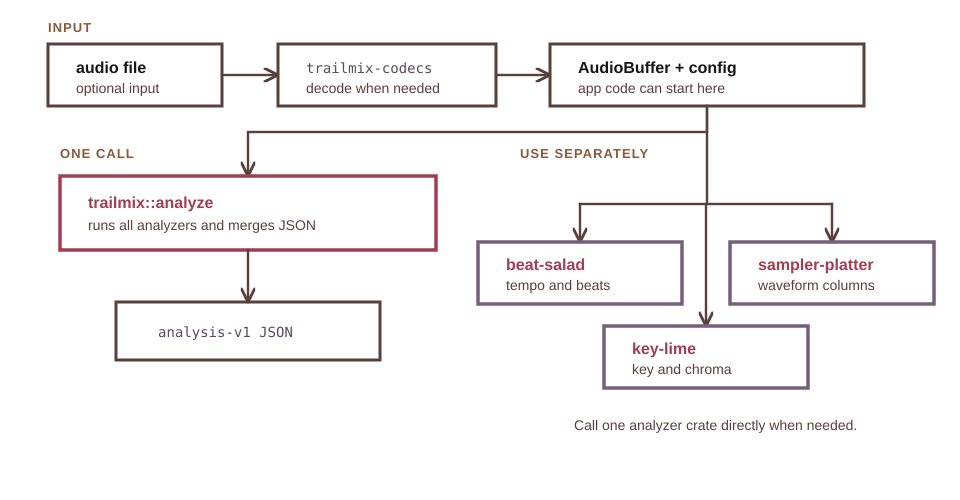
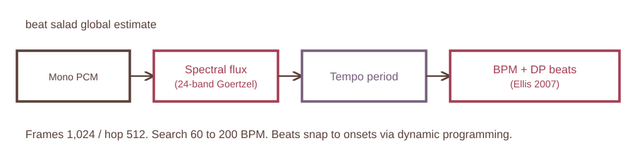
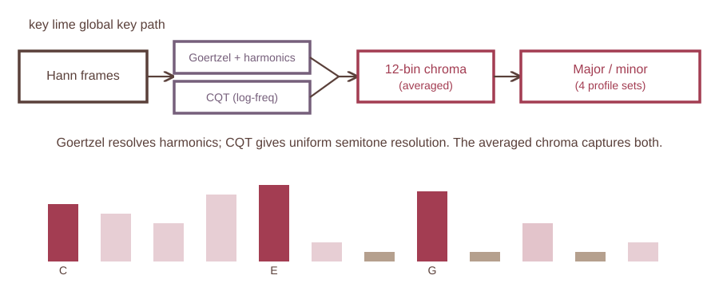
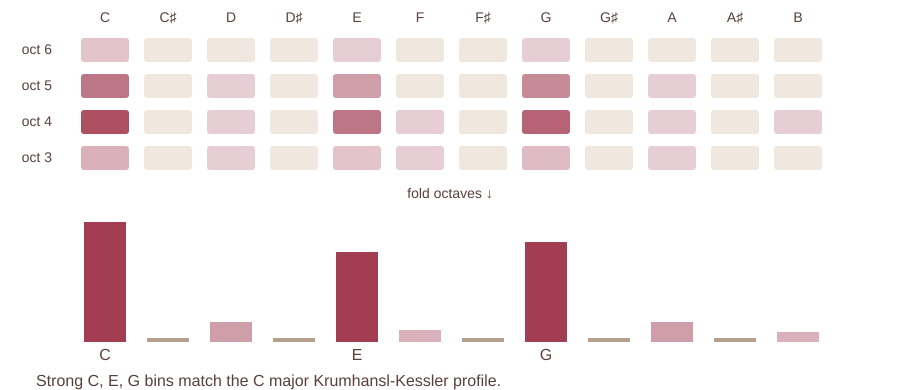
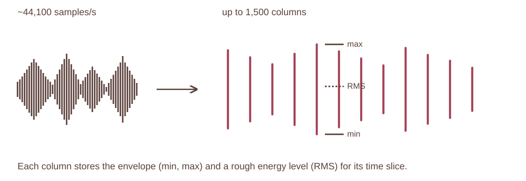

# Architecture

**trail mix** is a Rust workspace. beat salad, key lime, and sampler platter
are independent analyzer crates. <strong class="crate-name">trailmix</strong>
is a facade that runs all three over one audio buffer when an application wants
a single versioned result. <strong class="crate-name">trailmix-codecs</strong>
decodes audio files into the mono PCM the analyzers expect.

<figure class="diagram">
  
</figure>

## How analysis runs

Both entry points use an `AudioBuffer`, which is borrowed mono samples plus a
sample rate, and an `AnalysisConfig` with per-analyzer settings. Applications
that need all outputs call the facade and store the serialized `Analysis`
result; applications that only need tempo, key, or waveform data can call the
matching analyzer crate. Direct crate calls return the same nested result types
used by the facade: `BeatAnalysis`, `KeyAnalysis`, and `WaveformOverview`.

## Result types

The combined result contains `beat: BeatAnalysis`, `key: KeyAnalysis`, and
`waveform: WaveformOverview`. Calling an analyzer crate directly returns the
same result type for that analyzer.

- beat salad: `BeatAnalysis` with tempo and
  beat data. `global_bpm` is the precise track-level tempo estimate.
  `display_bpm` is the UI-friendly rounded BPM chosen to fit the beat timing.
  `tempo_segments` are sections where BPM changes over time. `beats` are timed
  beat positions with a confidence value and 4/4 `position_in_bar`.
- key lime: `KeyAnalysis` with global key,
  local key segments, the key estimator used, and the DSP key used as the
  transformer reranker prior. `key` is the selected global key. `segments` are
  local key regions. `estimator` records whether the result came from DSP or
  the reranker. `dsp_key` keeps the DSP prior. `chroma` stores the global
  pitch-class profile.
- sampler platter: `WaveformOverview` with
  compact waveform columns for drawing an overview without storing full PCM.
  `columns` are display buckets. Each column stores `min`, `max`, and `rms`
  values.
- Benchmark features: optional training and evaluation features.
  `key_chroma_frames` are frame-level chroma vectors. `key_scores` are DSP key
  candidate scores. Confidence values are carried on beat, tempo-segment, key,
  and key-segment outputs.

## beat salad

beat salad estimates tempo, beat positions, and local tempo segments.

<figure class="diagram">
  
  <figcaption>beat salad global estimate. 1,024-frame window, 512 hop, and 60-200 BPM search range.</figcaption>
</figure>

- Onset detection uses 24-band spectral flux rather than RMS energy
  differencing. Goertzel filters are spaced logarithmically from 50 Hz to
  11 kHz, and the onset-strength function sums only positive per-band energy
  increases, so it responds to note onsets, chord changes, and percussion over
  sustained bass (Bello et al. 2005).
- Beat tracking uses dynamic programming (Ellis 2007). For each onset-strength
  frame the tracker finds the predecessor beat that maximizes cumulative onset
  strength plus a Gaussian penalty for deviation from the expected inter-beat
  interval, then backtraces from the best endpoint. This follows swing, rubato,
  and live timing that a fixed grid cannot.
- Tempo estimation applies a gentle octave prior (sigma 2 octaves, centered on
  120 BPM) to reduce half and double errors without penalizing fast tempos.
- Display BPM is a separate integer, chosen by fitting the floor and ceiling
  candidates around the precise BPM to the detected beats and keeping the lower
  residual.
- Beat positions carry a `position_in_bar` field (1-4, assuming 4/4) for
  downbeat inference.

## key lime

key lime builds frame-level pitch-class profiles and classifies key at the
global and segment levels.

<figure class="diagram">
  
  <figcaption>key lime global key pipeline. Hann frames feed dual chroma extraction and profile matching.</figcaption>
</figure>

<figure class="diagram">
  
</figure>

- Dual chroma extraction computes each frame with both Goertzel filters, for
  harmonic-series resolution, and a Constant-Q Transform, for semitone
  separation at low frequencies. The two normalized vectors are averaged
  (Brown 1991; Schorkhuber and Klapuri 2010).
- Harmonic summation on the Goertzel path adds energy from the 2nd, 3rd, and
  4th harmonics (at +12, +19, +24 semitones) with configurable weights.
- Multiple key profiles score each candidate against Krumhansl-Kessler (1982),
  Temperley (2001), EDMA (Faraldo et al. 2016), and corpus-learned profiles,
  then average the families so no single family dominates close decisions.
- Tuning estimation detects a sub-semitone offset and shifts chroma before
  classification.
- Median chroma aggregation takes the per-pitch-class median across
  onset-weighted frames, which suppresses transient events.
- Spectral whitening compresses chroma bins before normalization so dominant
  frequencies do not overwhelm the vector.
- Relative-key disambiguation breaks close ties by tonic chroma energy.
- Confidence-gated segmentation and segment-majority voting produce the local
  key segments and the global key.

The global key is reranked by a compact transformer. The
[Transformer](TRANSFORMER.md) page covers the model, validation, and references.

## sampler platter

sampler platter bins PCM into waveform columns. Each column stores raw min, max,
and RMS values plus a display height and log-spaced band-energy color hints, so
an application can draw an overview without keeping full PCM.

<figure class="diagram">
  
  <figcaption>Each display column stores min, max, and RMS for its slice of the waveform.</figcaption>
</figure>

## Current limitations

- Tempo and beat tracking use DSP, not a trained model.
- Tempo segments are locally stable estimates, not a continuous ramp between two
  BPM values. When a secondary tempo covers a configurable share of the file
  (default 25%), beat salad sets `multi_tempo` and `alternate_bpm`, and key lime
  does the same with `multi_key` and `alternate_key`. This targets mashups and
  medleys in one file, not half or double counting of one pulse.
- Key segmentation does not yet represent modal or no-key sections.
- Confidence values are preliminary and not calibrated on held-out recordings.

## References

- Bello, J. P. et al. (2005). [A tutorial on onset detection in music
  signals](https://doi.org/10.1109/TSA.2005.851998). IEEE Transactions on
  Speech and Audio Processing.
- Brown, J. C. (1991). [Calculation of a constant Q spectral
  transform](https://doi.org/10.1121/1.400476). JASA.
- Ellis, D. P. W. (2007). [Beat tracking by dynamic
  programming](https://doi.org/10.1080/09298210701653344). Journal of New Music
  Research.
- Faraldo, A. et al. (2016). [Key estimation in electronic dance
  music](https://doi.org/10.1007/978-3-319-30671-1_25). ECIR.
- Krumhansl, C. L. and Kessler, E. J. (1982). [Tracing the dynamic changes in
  perceived tonal organization](https://doi.org/10.1037/0033-295x.89.4.334).
  Psychological Review.
- Schorkhuber, C. and Klapuri, A. (2010). [Constant-Q transform toolbox for
  music processing](https://doi.org/10.5281/zenodo.849741). SMC.
- Temperley, D. (2001). [The Cognition of Basic Musical
  Structures](https://mitpress.mit.edu/9780262201346/the-cognition-of-basic-musical-structures/).
  MIT Press.
