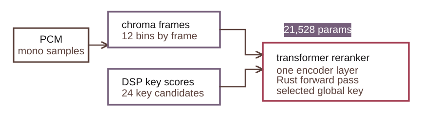
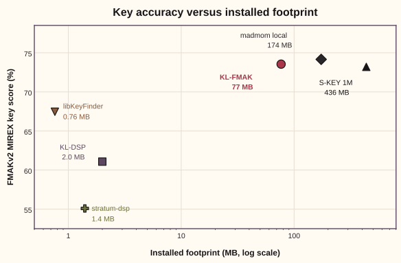

# Transformer

The transformer is the learned reranker inside key lime's global-key estimator.
It keeps the DSP analyzer in the loop: key lime first extracts chroma, scores
all 24 major and minor keys with profile-based DSP, and then lets the reranker
choose the final global key from the same evidence.

<figure class="diagram">
  
  <figcaption>key lime global-key reranker. Chroma frames and DSP key scores feed a compact transformer that chooses the global key.</figcaption>
</figure>

## Why it exists

Profile-based key estimators are small, portable, and easy to inspect. Close-key
cases are the hard part: relative, parallel, and fifth-related keys can all have
evidence in the same track. The key lime scorer keeps the DSP ranking and adds a small
sequence model that reads the frame-level chroma before choosing the global key.

The learned model reuses the same chroma features and the same 24 DSP key scores
that key lime already computes for local analysis. It reranks the DSP evidence
rather than replacing the rest of key lime.

## Model

The reranker has 21,528 parameters. It uses a circular pitch-class input stage,
one transformer encoder layer, and a residual projection over the DSP key
scores. The circular input lets the model read transposed pitch-class patterns
without treating C and B as far apart.

The Rust crate embeds the selected seed-1729 weights and runs the forward pass
directly. The release build does not require ONNX Runtime. Tests compare Rust
logits against the ONNX reference artifact so the packaged model remains the
same model used for validation.

## Validation

Validation answers one practical question: does the small reranker
improve global-key choice while keeping the same DSP features and output shape?
On the sealed 1,000-track FMAKv2 holdout, the answer is yes.

  <article class="metric-card">
    <h3>DSP scorer</h3>
    
<strong>61.08</strong> MIREX key score

    
<strong>52.30%</strong> exact accuracy

  </article>
  <article class="metric-card">
    <h3>Reranker average</h3>
    
<strong>73.55</strong> MIREX key score

    
<strong>67.07%</strong> exact accuracy

  </article>
  <article class="metric-card">
    <h3>Selected model</h3>
    
<strong>73.53</strong> MIREX key score

    
<strong>67.00%</strong> exact accuracy

  </article>

The reranker average is computed across three training seeds. The selected model
is the seed-1729 artifact used for runtime and release checks; the paper's
headline row remains the three-seed average.

MIREX key score gives partial credit for fifth, relative, and parallel-key
errors, so it is more useful than exact accuracy when a model moves an estimate
to a musically close key.

  

FMAKv2 MIREX key score against installed footprint. KL-DSP is the deterministic
key lime scorer and KL-FMAK is the transformer reranker.

## Paper

The model, training setup, and evaluation are described in the key lime paper.
The arXiv preprint link will be added here when the preprint is posted
(arXiv: TBD).

## References

- [MIREX Audio Key Detection](https://music-ir.org/mirex/wiki/Audio_Key_Detection)
  defines the tonic-plus-mode task and the partial-credit score for fifth,
  relative, and parallel-key errors.
- Vaswani, A. et al. (2017). [Attention is all you
  need](https://doi.org/10.48550/arXiv.1706.03762). NeurIPS. The transformer
  encoder architecture.
- Korzeniowski, F. and Widmer, G. (2018). [Genre-agnostic key classification
  with convolutional neural
  networks](https://doi.org/10.48550/arXiv.1808.05340). ISMIR. The learned
  global-key baseline used by madmom.
- Krumhansl, C. L. and Kessler, E. J. (1982). [Tracing the dynamic changes in
  perceived tonal organization](https://doi.org/10.1037/0033-295x.89.4.334).
  Psychological Review. The profile family used by the DSP scorer.
- Faraldo, A. et al. (2016). [Key estimation in electronic dance
  music](https://doi.org/10.1007/978-3-319-30671-1_25). ECIR. The EDMA profiles.
- [libKeyFinder](https://mixxxdj.github.io/libkeyfinder/), a compact C++ library
  for profile-based musical-key estimation.
